# image_processing — vision subsystem

This package turns the OAK-D camera feed into target positions that the mission script (`spar_node/scripts/demo_div`) can fly to. It finds two kinds of target:

- **ArUco markers** (landing markers): found by OpenCV on the Raspberry Pi, positioned by solving the camera-to-marker pose (PnP).
- **People and backpacks** (payload-drop targets): found by a YOLOv11 network running on the OAK-D's own processor (Myriad X VPU), positioned using the camera's stereo depth.

Every detection starts out in the camera's optical frame. TF then puts it into the `map` frame, using the motion-capture pose of the UAV and a fixed transform for how the camera is mounted.

This document is the reference for how the subsystem works: what each node does, what image sizes and rates it uses, how each number is calculated, and exactly how `demo_div` uses the outputs. Every value quoted here was read from the code. If you change a value in a script, update it here too.

---

## Contents

1. [Hardware and where the camera feed comes from](#1-hardware-and-where-the-camera-feed-comes-from)
2. [How it is launched](#2-how-it-is-launched)
3. [Data-flow overview](#3-data-flow-overview)
4. [Frame sizes, formats and rates (summary table)](#4-frame-sizes-formats-and-rates)
5. [Node: `dai_publisher_yolov11_runner.py` (camera + YOLO)](#5-node-dai_publisher_yolov11_runnerpy)
6. [Node: `aruco_subscriber.py` (ArUco)](#6-node-aruco_subscriberpy)
7. [Node: `tf2_broadcaster_frames.py` (camera mount)](#7-node-tf2_broadcaster_framespy)
8. [Node: `target_tf2_broadcaster.py` (camera → target TF)](#8-node-target_tf2_broadcasterpy)
9. [Node: `target_tf2_listener.py` (map-frame resolution + confirmation)](#9-node-target_tf2_listenerpy)
10. [Test tool: `fake_pub.py`](#10-test-tool-fake_pubpy)
11. [Coordinate frames and the TF tree](#11-coordinate-frames-and-the-tf-tree)
12. [Messages](#12-messages)
13. [Topic / TF reference](#13-topic--tf-reference)
14. [Interaction with other subsystems (`demo_div`)](#14-interaction-with-other-subsystems-demo_div)
15. [Worked numbers](#15-worked-numbers)
16. [Tunables](#16-tunables)
17. [Debugging and pre-flight checks](#17-debugging-and-pre-flight-checks)
18. [Known quirks and limitations](#18-known-quirks-and-limitations)

---

## 1. Hardware and where the camera feed comes from

| Item | Detail |
|---|---|
| Camera | Luxonis **OAK-D**, connected to the Raspberry Pi over USB |
| RGB sensor | `CAM_A`, run at 1080p (1920×1080, the DepthAI default). The ISP scales it by 2/3 to **1280×720** |
| Stereo pair | `CAM_B` (left) and `CAM_C` (right) mono cameras at **640×400 (400P)**, **10 fps** |
| On-camera compute | Myriad X VPU. It runs YOLO, stereo depth, the frame-gating script and the MJPEG encoder |
| Host | Raspberry Pi (ROS Noetic, OpenCV 4.2 from ROS). Runs every ROS node in this package |
| Mount | Points straight down. The top of the image faces the front of the drone (see §7) |

**The camera feed has a single source.** The only node that talks to the camera hardware is `dai_publisher_yolov11_runner.py`, through the DepthAI Python API (`dai.Device()`). Everything else in the system gets imagery from the ROS topics it publishes:

- `/depthai_node/image/compressed`: the main 1280×720 MJPEG video. `aruco_subscriber.py` uses it for detection, and it can be viewed on the GCS.
- `/depthai_node/camera/camera_info`: the factory calibration for that 1280×720 video. `aruco_subscriber.py` uses it for PnP, and `demo_div` uses it to work out lane spacing.
- `/depthai_node/detection/compressed`: the 640×640 YOLO overlay, for display only.

YOLO never goes through ROS for its input. The network runs on the camera and reads frames straight from the camera's internal pipeline.

The camera calibration (intrinsics and distortion) is **read from the OAK-D's factory EEPROM** each time the device connects (`device.readCalibration()`). Nothing is hard-coded.

---

## 2. How it is launched

Every node in this package is started by `catkin_ws/launch/combined_nodes.launch`, which also starts the servo node (`actuator_control/servo.py`):

```xml
dai_publisher_yolov11_runner.py   # camera, YOLO, video, camera_info
aruco_subscriber.py               # ArUco detection on the video
tf2_broadcaster_frames.py         # static uavteam8 -> camera, with camera_yaw_deg = 90
target_tf2_broadcaster.py         # camera -> target_*_temp TF + merged stream
target_tf2_listener.py            # map-frame resolution, ArUco lock-in, YOLO confirmation -> ROI
actuator_control/servo.py         # payload drop services (not part of this package)
```

The repo's tmux helpers start it as follows:

- On the UAV stack (`docker/bashrc.d/uav.sh`): the "vision + servo" pane runs `roslaunch $CATKIN_WS/launch/combined_nodes.launch`.
- On the GCS standalone stack (`docker/bashrc.d/gcs.sh`): it runs in its own pane next to `demo_div`, rviz (`rviz/gcs_rviz.rviz`) and `voice.launch`.

**External dependency:** to get anything into the `map` frame, something must publish `map → uavteam8`:

- On the real UAV, this is `vrpn_client_node` (started by `qutas_lab_450 environment.launch` → `vrpn_optiTrack.launch`, `broadcast_tf: true`, `frame_id: map`, tracker `uavteam8`, 100 Hz).
- In simulation, it is the UAVASR emulator (`spar_uavasr.launch`, `model_id = uavteam8`).
- MAVROS does **not** publish TF (`tf.send: false` in `px4_config.yaml`).

Without `map → uavteam8`, all three of these fail with TF lookup warnings: `target_tf2_listener`, the ArUco cache in `demo_div`, and YOLO confirmation.

`rviz/gcs_rviz.rviz` has fixed frame `map`. It shows TF (including the target frames), `/path`, the mocap pose, and two image panels: `/depthai_node/detection` and `/processed_aruco/image`, both with the `compressed` transport hint.

---

## 3. Data-flow overview

```mermaid
flowchart LR
    subgraph OAKD["OAK-D (on-device pipeline)"]
        RGB["ColorCamera CAM_A<br/>1080p sensor → ISP ×2/3 = 1280×720<br/>15 fps"]
        PREV["preview 640×640 BGR<br/>(centre-crop of 720p)"]
        VID["video 1280×720 NV12"]
        SCRIPT["Script node<br/>pass every 2nd frame"]
        ENC["VideoEncoder<br/>MJPEG q60"]
        MONO["Mono L/R 640×400<br/>10 fps"]
        STEREO["StereoDepth<br/>aligned to CAM_A"]
        NN["YoloSpatialDetectionNetwork<br/>best.blob, 2 classes"]
        RGB --> PREV --> SCRIPT --> NN
        RGB --> VID --> ENC
        MONO --> STEREO --> NN
    end

    ENC -- "video" --> DAI
    NN -- "nn + nn_input (passthrough)" --> DAI

    DAI["dai_publisher_yolov11_runner.py<br/>(node: depthai_node)"]
    DAI -->|/depthai_node/image/compressed<br/>1280×720 JPEG, 15 Hz| ARUCO
    DAI -->|/depthai_node/camera/camera_info<br/>10 Hz| ARUCO
    DAI -->|/depthai_node/detection/compressed<br/>640×640 overlay| GCS[(GCS rviz)]
    DAI -->|/target_detections/yolo| TBC

    ARUCO["aruco_subscriber.py"] -->|/target_detections/aruco| TBC
    ARUCO -->|/processed_aruco/image/compressed<br/>640×360, ≤5 Hz| GCS

    TBC["target_tf2_broadcaster.py"] -->|TF camera → target_*_temp| TFTREE[(TF)]
    TBC -->|/target_detections/camera_frame| TL
    TL["target_tf2_listener.py"] -->|static TF map → target_aruco_N| TFTREE
    TL -->|/target_detection/roi<br/>confirmed person/backpack| DEMO
    TL -->|/target_detections/world| NONE[(no subscriber in repo)]

    ARUCO -->|/target_detections/aruco| DEMO
    DAI -->|/target_detections/yolo| DEMO
    DAI -->|camera_info at startup| DEMO
    DEMO["demo_div (mission)"] -->|Trigger /actuator_control/drop_a or drop_b| SERVO["servo.py"]
```



In words:

1. The OAK-D produces three streams from one RGB camera:
   - full-FOV 720p MJPEG video
   - a 640×640 crop that feeds YOLO
   - stereo depth, which YOLO uses to give each box a 3D position
2. The **YOLO path** publishes 3D detections in the camera frame (`/target_detections/yolo`).
3. The **ArUco path** decodes the 720p video on the Pi and solves PnP for each marker (`/target_detections/aruco`).
4. Both streams go to `target_tf2_broadcaster.py`, which turns each detection into a TF frame (`camera → target_*_temp`).
5. `target_tf2_listener.py` looks those frames up in `map`:
   - **ArUco:** locks each marker in permanently, as a static frame `map → target_aruco_<id>`.
   - **Person/backpack:** confirms the target (5 sightings within 30 cm), then publishes it once on `/target_detection/roi`.
6. `demo_div` uses three of these feeds:
   - raw YOLO, to stop the scan
   - ROI, to fly to the target and drop the payload
   - raw ArUco, to build its own averaged landing-marker estimates

---

## 4. Frame sizes, formats and rates

| Stream / topic | Resolution | Format | Nominal rate | Produced by | Consumed by |
|---|---|---|---|---|---|
| RGB sensor output (ISP in) | 1920×1080 | raw | 15 fps (`CAM_FPS`) | OAK-D CAM_A | ISP |
| ISP output | **1280×720** | YUV | 15 fps | `setIspScale(2, 3)` | video, preview |
| `cam.video` → VideoEncoder | 1280×720 | NV12 → MJPEG, quality 60 | 15 fps | on-device | XLink `video` |
| **`/depthai_node/image/compressed`** | **1280×720** | `sensor_msgs/CompressedImage`, JPEG (hardware MJPEG, q60), `frame_id: "home"` | 15 Hz (camera rate). The Pi was measured delivering about 15 Hz in the 2026-09-28 bag | `dai_publisher_yolov11_runner.py` | `aruco_subscriber.py`, GCS, rosbag |
| **`/depthai_node/camera/camera_info`** | describes 1280×720 | `sensor_msgs/CameraInfo`, `frame_id: camera` | 10 Hz (timer) | `dai_publisher_yolov11_runner.py` | `aruco_subscriber.py`, `demo_div` (once at startup) |
| `cam.preview` (NN input) | **640×640** | BGR planar | 15 fps out of the camera, **every 2nd frame** reaches the NN (`DETECT_EVERY_N = 2`), about **7.5 Hz** | on-device | Script → YOLO |
| Mono left/right | 640×400 (400P) | GRAY8 | 10 fps | CAM_B / CAM_C | StereoDepth |
| Depth | aligned to the RGB (CAM_A) viewpoint | uint16 mm | 10 fps | StereoDepth | YOLO spatial |
| **`/depthai_node/detection/compressed`** | **640×640** (NN passthrough frame plus boxes) | JPEG q60, encoded on the Pi CPU, `frame_id: "home"` | YOLO rate (about 7.5 Hz) | `dai_publisher_yolov11_runner.py` | GCS rviz "ML Detection" |
| **`/target_detections/yolo`** | n/a | `TargetDetectionArray`, `frame_id: camera` | YOLO rate (about 7.5 Hz; one message per NN result, including empty ones) | `dai_publisher_yolov11_runner.py` | `target_tf2_broadcaster.py`, `demo_div` |
| ArUco detection input | **1280×720** (decoded on the Pi; grayscale unless an annotated frame is due) | numpy | **every 5th** received frame (`DETECT_EVERY_N = 5`), about **3 Hz** at 15 Hz input | `aruco_subscriber.py` | n/a |
| **`/processed_aruco/image/compressed`** | **640×360** (720p downscaled to `viz_width=640`, INTER_AREA) | JPEG q60 | ≤ 5 Hz (`viz_rate`), and never faster than detection (about 3 Hz). **Only published while someone is subscribed** | `aruco_subscriber.py` | GCS rviz "Aruco Detection" |
| **`/target_detections/aruco`** | n/a | `TargetDetectionArray`, `frame_id: camera` | ArUco detection rate (about 3 Hz; empty arrays included) | `aruco_subscriber.py` | `target_tf2_broadcaster.py`, `demo_div` |

**The NN's 640×640 image is a centre square crop, not the full frame.** The DepthAI preview keeps the aspect ratio by default. It therefore takes the centre **720×720** of the 1280×720 ISP image and scales it to 640×640. YOLO sees about 42° × 42°, while the video covers about 69° × 42°. This is why `demo_div` spaces its lanes using the NN's field of view rather than the full camera field of view (§14.1, §15).

---

## 5. Node: `dai_publisher_yolov11_runner.py`

ROS node name: `depthai_node` (launched as `dai_publisher_yolov11_runner`). It is the only process that opens the camera.

### 5.1 Model

`models/best_openvino_2022.1_6shave/`:

| Field (`best.json`) | Value |
|---|---|
| Family / format | YOLO, `detection` output |
| Input size | **640×640** |
| Classes | 2 → `labels = ["person", "backpack"]` |
| Coordinates | 4 |
| Anchors / masks | empty (YOLOv11 is anchor-free) |
| Confidence threshold | **0.5** (applied on device) |
| IoU threshold (NMS) | **0.5** |
| Blob | `best_openvino_2022.1_6shave.blob`, OpenVINO 2022.1, compiled for 6 SHAVEs |

The script reads the model path through `rospkg`, so the blob must be in the package's `models/` directory. If `best.json` is missing, the node raises `ValueError` at import time.

### 5.2 On-device pipeline (`createPipeline`)

- **ColorCamera (CAM_A)**
  - `setFps(15)`
  - `setIspScale(2, 3)` → 1280×720
  - `setVideoSize(1280, 720)`
  - `setPreviewSize(640, 640)`, BGR, planar (non-interleaved)
- **Script node**
  - Input `frames` is non-blocking with queue size 1.
  - It counts preview frames and forwards every `DETECT_EVERY_N` (2nd) frame to the NN. This separates the detection rate from the video rate.
- **YoloSpatialDetectionNetwork**
  - Confidence 0.5, IoU 0.5, 2 classes.
  - 4 pool frames, 2 inference threads, non-blocking input.
  - `setBoundingBoxScaleFactor(0.5)`: depth is sampled only from the **middle 50%** of each box (in each dimension), so background pixels at the box edges are not included.
  - Depth range is valid from **100 mm to 10 000 mm**. Pixels outside 0.1–10 m are ignored.
- **Mono L/R**
  - 400P at **10 fps**. This is deliberately lower than 15 fps, because depth only needs to be current when the NN runs.
- **StereoDepth**
  - Left-right check on. Extended disparity and subpixel are off (to save compute).
  - `setDepthAlign(CAM_A)` reprojects depth to the RGB viewpoint, so the YOLO boxes and the depth pixels line up.
- **VideoEncoder**
  - MJPEG at 15 fps, quality 60, fed from `cam.video`.
  - The Pi never encodes the main video. It only forwards the bytes.
- **XLinkOut streams** (all non-blocking on the device side):
  - `video`: the encoded MJPEG
  - `nn`: the detections
  - `nn_input`: the NN passthrough frame, the exact 640×640 image the NN ran on

### 5.3 Host loop (`run`)

1. Open the device. If either mono camera is missing (no stereo, so no spatial positions), raise. Log the USB speed.
2. `read_calibration()`:
   - `K = getCameraIntrinsics(CAM_A, 1280, 720)`, flattened to 9 values
   - `D = getDistortionCoefficients(CAM_A)`
   - These intrinsics are computed **for the 1280×720 video**, not for the NN preview.
3. Start the pipeline. Queues:
   - `video`: blocking, maxSize 4. This queue sets the pace of the loop, at 15 Hz.
   - `nn` and `nn_input`: non-blocking (`tryGet`), maxSize 4.
4. For each video frame, publish the JPEG bytes on `/depthai_node/image/compressed`.
5. Pair up an `nn_input` frame with an `nn` result that has the **same sequence number**:
   - Whichever arrives first is kept until its partner arrives.
   - If the sequence numbers don't match, the older one is dropped, because its partner was lost.
   - When a pair matches, the loop does the following:
     - Draws the overlay (boxes, label, confidence %, `Z: x.xx m`, NN fps, found classes) and publishes it as JPEG q60 on `/depthai_node/detection/compressed`.
     - Publishes the detections on `/target_detections/yolo`.
6. On `RuntimeError` (e.g. `X_LINK_ERROR`, usually a USB brownout):
   - Clear the calibration, which stops camera_info from being published.
   - Wait 2 s, then `main()` calls `run()` again to reconnect. The node itself never dies on a camera drop.

### 5.4 How a YOLO position is calculated

The DepthAI `YoloSpatialDetectionNetwork` calculates the position for each box on the device:

1. Take the box, shrink it to its centre 50% (scale factor 0.5), and project that region onto the aligned depth map.
2. Combine the valid depth pixels in that region (100–10 000 mm) into a single depth **Z** (mm). The combining method is DepthAI's spatial calculator default.
3. Calculate **X** and **Y** (mm) from the centre of the region and Z, using the camera's angular field of view: roughly `X = Z · tan(angle_x)` and `Y = Z · tan(angle_y)`.

The node then converts to metres and to the OpenCV optical-frame convention (`publish_targets`):

```
position.x =  spatialCoordinates.x / 1000      # right
position.y = -spatialCoordinates.y / 1000      # DepthAI Y is UP; optical frame Y is DOWN -> negate
position.z =  spatialCoordinates.z / 1000      # forward along the optical axis (= down, for this mount)
```

The Y negation matters. Without it, a person in front of the drone would come out behind it, given the current mount.

Each YOLO detection is published with:

| Field | Value |
|---|---|
| `label` | `"person"` or `"backpack"` |
| `marker_id` | -1 |
| `confidence` | the NN score (≥ 0.5) |
| `header.frame_id` | `camera` |

### 5.5 Timestamps

`ros_stamp()` converts the device's **capture time** into ROS time:

```
stamp = rospy.Time.now() − (dai.Clock.now() − msg.getTimestamp())
```

The video, the overlay and the detections all carry the capture time, not the publish time. The publish time is at least 100 ms later once inference and USB transfer are included. Downstream TF lookups at `header.stamp` therefore use the UAV pose **at the moment the frame was taken**.

### 5.6 camera_info contents

Published at 10 Hz, and only once calibration has been read:

| Field | Value |
|---|---|
| `header.frame_id` | `camera` (param `~camera_frame_id`) |
| `width` × `height` | 1280 × 720 |
| `K` | factory intrinsics for 1280×720 |
| `D` | factory distortion coefficients |
| `distortion_model` | `rational_polynomial` if there are more than 5 coefficients (normal for an OAK-D), otherwise `plumb_bob` |
| `R` | identity |
| `P` | `[fx 0 cx 0; 0 fy cy 0; 0 0 1 0]` |

---

## 6. Node: `aruco_subscriber.py`

ROS node name: `EGB349_vision` (anonymous), launched as `aruco_subscriber`.

### 6.1 Inputs

- `/depthai_node/image/compressed` (`queue_size=1`, `buff_size=16 MB`). It always processes the **newest** frame and drops any backlog, so lag can't build up.
- `/depthai_node/camera/camera_info`. Sets `K`, `D`, and the image size the intrinsics are valid for.

### 6.2 Per-frame logic (`img_callback`)

1. **No camera_info yet:** skip, logging a warning every 5 s. It never uses placeholder intrinsics.
2. **Decimation:** only every `detect_every_n` (default **5**) received frame is processed. Skipped frames return before the JPEG is decoded, so they cost almost nothing.
3. **Decide whether to annotate:** annotate only if `/processed_aruco/image/compressed` has a subscriber **and** at least `1/viz_rate` (0.2 s) has passed since the last annotated frame.
   - Annotating: decode in colour with `cv_bridge`.
   - Otherwise: decode straight to **grayscale** with `cv2.imdecode(..., IMREAD_GRAYSCALE)`, which is faster.
4. **Size guard:** if the decoded size does not match the camera_info size, refuse to publish poses (error every 5 s). Intrinsics for one size give wrong distances at another size, without any error.
5. Detect markers, estimate their poses, publish.

### 6.3 Detection and pose maths

| Step | Detail |
|---|---|
| Dictionary | `DICT_5X5_100` (IDs 0–99) |
| Detector params | OpenCV defaults. Uses `ArucoDetector` on OpenCV ≥ 4.7, or `cv2.aruco.detectMarkers` on Noetic's 4.2. Both work |
| Marker side | `~marker_length` = **0.20 m** (printed size, per the customer spec) |
| Object points | Marker corners in the marker frame, in TL, TR, BR, BL order: `(−s/2, +s/2, 0)`, `(+s/2, +s/2, 0)`, `(+s/2, −s/2, 0)`, `(−s/2, −s/2, 0)`, with s = 0.20 |
| Solver | `cv2.solvePnP(obj_pts, img_corners, K, D, flags=SOLVEPNP_IPPE_SQUARE)`. IPPE_SQUARE is the closed-form solver built for exactly this case (four coplanar corners of a square). It gives the same result as the removed `estimatePoseSingleMarkers` |
| Output used | **`tvec`**: the marker centre in the camera optical frame, in metres. `rvec` (orientation) is only used to draw the axes and is **not published** |

The distortion model is the full factory model from camera_info, so solvePnP accounts for lens distortion. Corners near the edge of the image are corrected properly.

Each ArUco detection is published with:

| Field | Value |
|---|---|
| `label` | `"aruco"` |
| `marker_id` | the ID |
| `confidence` | 1.0 (a geometric detection, so there is no score) |
| `position` | `tvec` |

The message header **copies the image's stamp and seq** (the capture time), but **sets `frame_id` to `camera`** (`~camera_frame_id`) instead of inheriting the image's `"home"`.

### 6.4 Annotated output

The node draws on the full-resolution frame:

- the marker outline (green)
- the pose axes (0.1 m long)
- the ID
- the pixel centre `(cx, cy)` (red)

Line thickness and text size are multiplied by `frame_width / viz_width` (2× for 1280 → 640), so they stay readable after the downscale. The frame is then resized to `viz_width` = 640 wide (640×360) with `INTER_AREA`, encoded as JPEG q60, and published with stamp = now.

Logging: one throttled line per second, `AruCo Marker Detected, ID: …, Position (m): …`.

`self.marker_positions` keeps the latest `tvec` for each ID. Nothing reads it at the moment.

---

## 7. Node: `tf2_broadcaster_frames.py`

This node publishes a single **static** transform, `uavteam8 → camera`, which describes where the camera is mounted on the airframe.

| Param | Default | `combined_nodes.launch` |
|---|---|---|
| `~uav_frame` | `uavteam8` | n/a |
| `~camera_frame` | `camera` | n/a |
| `~camera_x` | −0.10 m (10 cm behind the body origin) | n/a |
| `~camera_y` | 0.0 m | n/a |
| `~camera_z` | −0.15 m (15 cm below) | n/a |
| `~camera_yaw_deg` | 0 | **90** |

Rotation: `quaternion_from_euler(0, π, yaw)` with static axes in the order x, y, z, which gives `R = Rz(yaw) · Ry(π)`. The π rotation about y points the camera down. The yaw then turns it about the UAV's z axis.

With `yaw = 90°`, the matrix is

```
R = Rz(90°)·Ry(180°) = [ 0 -1  0 ]
                       [-1  0  0 ]
                       [ 0  0 -1 ]
```

so the camera axes map onto the airframe as follows:

| Camera optical axis | Meaning in image | UAV body axis |
|---|---|---|
| +X | image right | **−Y** (UAV right) |
| +Y | image down | **−X** (UAV backward) |
| +Z | optical axis | **−Z** (down) |

In other words, **the top of the image is the front of the drone**. A camera-frame point `(x, y, z)` lands in the UAV body frame (x forward, y left, z up) at:

```
body = ( −y − 0.10,  −x,  −z − 0.15 )
```

Watch the sign of the yaw. Because the camera looks down, a positive yaw about the UAV's z axis looks negative through the lens. Flip the sign if you are matching what you see in the image rather than the airframe.

---

## 8. Node: `target_tf2_broadcaster.py`

This node turns detections into **live, camera-relative TF frames** and merges the two detection streams into one.

**Subscribes:** `/target_detections/yolo` and `/target_detections/aruco` (both handled by the same callback).

**Per message:**

1. Drop detections with `confidence < MIN_CONFIDENCE` (0.5). This never removes ArUco detections, which are always 1.0.
2. Work out the frame name for each detection:
   - ArUco: `target_aruco_<id>_temp`
   - YOLO: `target_<label>_temp`, e.g. `target_person_temp`
3. If several detections in one message share a name (two "person" boxes), keep only the one with the **highest confidence**.
4. For each remaining detection:
   - Broadcast `camera → <name>` immediately, with translation = `position`, identity rotation, and stamp = the message stamp (the capture time).
   - Update its **streak**: +1 if it was last seen ≤ `MAX_SIGHTING_GAP_SEC` (1.0 s) ago, otherwise reset to 1.
   - Once the streak reaches `CONFIRM_COUNT` (**3**), store the transform in a keep-alive cache.
5. Republish the surviving detections on **`/target_detections/camera_frame`**, with the original stamp and `frame_id: camera`.

**Keep-alive timer (10 Hz):**

- Any frame not seen for more than `STALE_TIMEOUT_SEC` (2.0 s) is removed from the cache.
- Every cached transform is re-sent with **stamp = now**. This keeps confirmed frames visible in rviz and in `tf_echo` through short detection dropouts.

The `_temp` suffix marks these frames as live and camera-relative: they move with the drone. The permanent, world-fixed ArUco frames that `target_tf2_listener.py` publishes have no suffix, so the two nodes never clash and need no coordination.

> The keep-alive cache and its 3-sighting streak only affect **what is visible in TF**. The confirmation that actually triggers a payload drop happens in `target_tf2_listener.py` (§9).

---

## 9. Node: `target_tf2_listener.py`

This node resolves each detection into `map` and decides what is trustworthy.

**Subscribes:** `/target_detections/camera_frame`.

For each detection it looks up `map → <name>_temp` **at the message's stamp** (timeout 0.5 s). Because the broadcaster sent that exact transform with that stamp just before republishing, the lookup composes the following, all at the moment of capture:

```
map → uavteam8      (mocap pose at capture time)
uavteam8 → camera   (static mount, §7)
camera → target     (the detection)
```

### 9.1 ArUco: trusted on the first sighting

- The first time a marker ID resolves, the node broadcasts a **static** transform `map → target_aruco_<id>` with the resolved position and identity rotation, logs it, and adds the ID to `confirmed`.
- Later sightings of that ID are ignored. The frame is never updated.
- Static transforms are latched, so the frame stays at that world position for the rest of the session, whatever the drone does. If the node restarts, the next sighting locks the marker in again.

### 9.2 Person/backpack: confirmed by consistency

1. Skip detections with confidence < 0.5.
2. Resolve to `map`. Append the result to a buffer for that frame name (`deque(maxlen=BUFFER_LEN=5)`).
3. The running estimate is the **mean of the buffer** (up to 5 points).
4. The target is **confirmed** when the buffer holds `CONFIRM_COUNT = 5` points **and every pair** of them is within `MAX_SPREAD_M = 0.30 m` (3D distance).
5. On confirmation, which happens **once per frame name** (and so once per label, because names are `target_person` and `target_backpack`):
   - Publish **`/target_detection/roi`**: a `TargetDetectionArray` with **exactly one** detection (label, confidence, averaged map position), `frame_id: map`.
   - Publish `/emulated_uav/target_found` (`std_msgs/Time`, the confirmation stamp). This is left over from the tutorial and nothing in the repo subscribes to it.
6. No permanent frame is kept for a person or backpack.

### 9.3 World stream

On every callback that produced something, the node publishes **`/target_detections/world`** (`frame_id: map`). It contains:

- ArUco: only at the moment the marker is locked in
- YOLO: the rolling average on every sighting

No node in the repo currently subscribes to this topic. It is meant for a GCS display or voice callouts.

---

## 10. Test tool: `fake_pub.py`

```
rosrun image_processing fake_pub.py [label]     # default label: person
```

Publishes 15 messages on `/target_detections/yolo` at 5 Hz. Each message contains:

- `frame_id: camera`
- `confidence: 0.9`
- position `(0.3, 0.3, 0.0)` in the camera frame, identical every time

Because the position never changes, the 30 cm spread check passes and the target confirms after 5 sightings. That triggers the full chain:

```
broadcaster → listener → /target_detection/roi → demo_div diversion
```

You can trigger a drop without a real target in view. **A `map → uavteam8` TF is still needed** for the listener to resolve the position. The GCS standalone tmux stack has this command ready in a pane, but does not run it automatically.

---

## 11. Coordinate frames and the TF tree

```
map                                   world frame (mocap origin)
 ├── uavteam8                         dynamic; vrpn_client_node (real) / uavasr emulator (sim)
 │    └── camera                      static;  tf2_broadcaster_frames.py (§7)
 │         ├── target_aruco_<id>_temp dynamic; target_tf2_broadcaster.py (live, camera-relative)
 │         ├── target_person_temp       "
 │         └── target_backpack_temp     "
 ├── target_aruco_<id>                static;  target_tf2_listener.py (permanent, first sighting)
 └── base_link                        (MAVROS pose frames; MAVROS TF is disabled)
```

| Frame | Convention |
|---|---|
| `map` | ENU-style, metres. The search area, Breadcrumb, SPAR and all mission waypoints are in this frame |
| `uavteam8` | UAV body: x forward, y left, z up |
| `camera` | **OpenCV optical frame**: x right, y down (in the image), z out of the lens. For this mount, z points at the ground |
| `target_*` | Translation only. Rotation is always identity, because no target orientation is estimated or published |

`"home"` is a label used only on the two image topics. It is **not** a TF frame that anything resolves. Every detection and the camera_info use `camera`.

**Frame-name convention**: three files must agree on it:

| Detection | Live name (broadcaster) | Permanent / standard name (listener, demo_div) |
|---|---|---|
| ArUco ID 7 | `target_aruco_7_temp` | `target_aruco_7` |
| person | `target_person_temp` | `target_person` |
| backpack | `target_backpack_temp` | `target_backpack` |

The three implementations are:

- `target_tf2_broadcaster.target_frame_name()`
- `target_tf2_listener.standard_frame_name()` / `temp_frame_name()`
- `demo_div.frame_name_for()`

The first two decide "ArUco or not" from `marker_id != -1`. `demo_div` decides from `label == "aruco"`, because an unset `int32` defaults to 0. With real data the results are the same.

---

## 12. Messages

`msg/TargetDetection.msg`:

```
string label                  # "aruco", "person", "backpack"
int32 marker_id               # ArUco ID if label == "aruco", otherwise -1
float32 confidence            # 1.0 for ArUco, YOLO score otherwise
geometry_msgs/Point position  # metres; camera optical frame (or map, on /world and /roi)
```

`msg/TargetDetectionArray.msg`:

```
Header header                 # stamp = capture time; frame_id says which frame `position` is in
TargetDetection[] detections
```

ArUco and YOLO use the same type, so every consumer handles only one message type. Check `header.frame_id` to know which frame the positions are in:

- `camera` on `/yolo`, `/aruco`, `/camera_frame`
- `map` on `/world`, `/roi`

---

## 13. Topic / TF reference

### Published by this package

| Topic | Type | Frame | Publisher |
|---|---|---|---|
| `/depthai_node/image/compressed` | CompressedImage (JPEG 1280×720) | `home` | dai_publisher |
| `/depthai_node/detection/compressed` | CompressedImage (JPEG 640×640) | `home` | dai_publisher |
| `/depthai_node/camera/camera_info` | CameraInfo (1280×720) | `camera` | dai_publisher |
| `/target_detections/yolo` | TargetDetectionArray | `camera` | dai_publisher (also `fake_pub.py`) |
| `/processed_aruco/image/compressed` | CompressedImage (JPEG 640×360) | n/a | aruco_subscriber |
| `/target_detections/aruco` | TargetDetectionArray | `camera` | aruco_subscriber |
| `/target_detections/camera_frame` | TargetDetectionArray | `camera` | target_tf2_broadcaster |
| `/target_detections/world` | TargetDetectionArray | `map` | target_tf2_listener |
| `/target_detection/roi` | TargetDetectionArray (1 detection) | `map` | target_tf2_listener |
| `/emulated_uav/target_found` | std_msgs/Time | n/a | target_tf2_listener |

Note that the ROI topic is **`/target_detection/roi`**, with singular "detection".

### TF published

| Transform | Kind | Publisher |
|---|---|---|
| `uavteam8 → camera` | static | tf2_broadcaster_frames |
| `camera → target_*_temp` | dynamic (on detection, plus 10 Hz keep-alive once confirmed) | target_tf2_broadcaster |
| `map → target_aruco_<id>` | static (first sighting) | target_tf2_listener |

### Required from outside

| What | From |
|---|---|
| `map → uavteam8` TF | vrpn_client_node (OptiTrack/Vicon) or the UAVASR emulator |
| OAK-D on USB with both mono cameras | hardware |

---

## 14. Interaction with other subsystems (`demo_div`)

`spar_node/scripts/demo_div` (ROS node `scan`) is the mission script, and every connection between vision and the rest of the system goes through it. It uses vision in **five** ways.

### 14.1 Startup: lane spacing from camera_info

Before planning, `demo_div` waits up to 5 s for one message on `~camera_info_topic` (default `/depthai_node/camera/camera_info`) and calculates the field of view **YOLO actually sees**:

```
half_width_px    = min(width, height) / 2      # 720/2 = 360 — the NN's centre-square crop
DETECTION_HFOV   = 2 · atan(half_width_px / fx)  [deg]
```

The NN input is the centre 720×720 of the 720p video, measured with the same `fx`. Using the full 1280-pixel width (about 69°) would space the lanes too far apart and leave strips that YOLO never sees.

Where the value comes from, in priority order:

1. the `_detection_hfov_deg` launch param
2. the camera_info measurement, logged as `Detection HFOV … (measured from …)`
3. the fallback `DETECTION_HFOV_DEG = 42.0`, logged as a warning

It is then used in `generate_lawnmower_waypoints()`:

```
footprint     = 2 · SCAN_HEIGHT · tan(HFOV / 2)       # ground width YOLO covers
lane_spacing  = footprint · (1 − LANE_OVERLAP)        # LANE_OVERLAP = 0.2
num_lanes     = max(2, ceil(width / lane_spacing) + 1)    # width = X_MAX − X_MIN
actual_spacing = width / (num_lanes − 1)
```

Lanes run along y, are spaced in x, and alternate direction. Each lane is just two waypoints, one at each end. See §15 for the numbers.

**Dependency:** if `dai_publisher` isn't running yet, or the camera hasn't connected within 5 s of `demo_div` starting, the 42° fallback is used. For the current camera it matches the measured value to within a fraction of a degree.

### 14.2 ArUco: `/target_detections/aruco` → `detection_callback`

`demo_div` subscribes to the **raw** ArUco topic directly. It does **not** use the listener's locked-in frames by default.

For each detection, `_transform_detection_position()` does the following:

1. Builds a `PointStamped` with `frame_id = header.frame_id` (`camera`; falls back to `~camera_frame` if empty) and `stamp = header.stamp`.
2. Calls `tf_buffer.transform(point, "map", timeout 0.2 s)`. This is the same `map ← uavteam8 ← camera` chain, evaluated at the capture time.
3. Passes the result to `update_frame_estimate("target_aruco_<id>", pos)`, which keeps a **running mean** for each frame name:
   - The first sighting creates the entry.
   - Once an entry has `MARKER_MIN_OBSERVATIONS = 3` sightings, any new sighting more than `MARKER_OUTLIER_DISTANCE = 1.0 m` (3D) from the current mean is **rejected** as an outlier.

These averaged estimates are what `/aruco/land` and `/aruco/roi` fly to. At the end of the scan, `log_frame_summary()` lists every frame with its position and number of observations.

### 14.3 YOLO raw: `/target_detections/yolo` → `yolo_callback` (stop the scan)

The raw YOLO feed is used **only to stop the UAV**. It never decides a position and never fires a payload by itself.

- For each detection whose label is in `DIVERSION_ACTUATOR` (`person`, `backpack`) and isn't already handled or pending, the label is added to `pending_diversions`.
- **ArUco false-positive filter.** YOLO sometimes reads part of an ArUco marker as a backpack or person. Before queuing, `yolo_callback` makes a best-effort attempt to transform the sighting into `map` (the same TF chain as §14.2). If the sighting lies within `ARUCO_EXCLUSION_RADIUS = 0.3 m` **horizontally** of any known marker's averaged position in `frame_estimates`, it is ignored and a warning is logged (`Ignoring '<label>' … likely the marker itself`). If the transform fails, the sighting is kept, and the same check runs on the confirmed position in `roi_callback` (§14.4). Setting `ARUCO_EXCLUSION_RADIUS = 0` turns the filter off. It only works for markers already seen in this run, so a marker that YOLO sees before ArUco has detected it is not filtered.
- `send_wp_scan()` checks this list every 0.1 s while flying a scan leg. If it is not empty, the node cancels the SPAR goal, waits 0.5 s, and the UAV **holds where it is**.
- Then `wait_for_confirmed_diversion()` waits up to `DIVERSION_CONFIRM_TIMEOUT = 4.0 s` for the listener to confirm the target (§14.4). The point of stopping is to hold still while the listener collects its 5 consistent sightings. At about 7.5 Hz YOLO, that takes at least about 0.7 s.
- If nothing is confirmed in time:
  - The leg is re-planned from the stop point, so no ground coverage is skipped.
  - After `MAX_UNCONFIRMED_STALL_RETRIES = 3` unconfirmed stops on the same leg, the rest of that leg is flown **ignoring raw sightings**, so a false positive that keeps flickering can't stall the mission. A target confirmed during that time is still handled at the end of the leg.

### 14.4 Confirmed ROI: `/target_detection/roi` → `roi_callback` → payload drop

This is the path that actually leads to a payload drop:

1. `target_tf2_listener` confirms a person or backpack (5 sightings, all within 30 cm) and publishes one detection in `map`.
2. `roi_callback` checks that the label is in `DIVERSION_ACTUATOR`, is not yet handled, and is **not within `ARUCO_EXCLUSION_RADIUS` of a known ArUco marker** (the same filter as §14.3, applied to the confirmed position). It then queues `{label, position}` in `pending_roi_diversions` and announces `"<label> found at x <x>, y <y>"` on `/voice/say`. The coordinates are rounded to 0.1 m and spoken as words, e.g. "minus 1.3".
3. The scan loop takes the entry and calls `handle_diversion()`. During it, the mission state is `deployment`, and it returns to `search` afterwards. The position from the listener is used **as is**, without resolving it again. Its z is ignored; only x and y are flown to. The steps are:
   - Fly to `(x, y, SCAN_HEIGHT)` along a Breadcrumb path, with nearby fallback points if that spot is blocked.
   - Descend to `DROP_HEIGHT = 0.8 m` and hover for `HOVER_BEFORE_DROP = 5 s`.
   - Call the actuator service, a `std_srvs/Trigger` that blocks until the rack has moved:
     - `person` → `drop_b` → `/actuator_control/drop_b` (Payload B, `drop_square`)
     - `backpack` → `drop_a` → `/actuator_control/drop_a` (Payload A, `drop_rect`)
   - Announce `Payload dropping`, then `Payload deployed` or `Payload deployment failed`. Wait `ACTUATOR_HOLD = 2 s`.
   - Add the label to `handled_targets`. That label is ignored for the rest of the flight.
   - Climb back to `SCAN_HEIGHT`, clear any raw sightings collected during the diversion (they are stale), and re-plan the interrupted leg from where the UAV now is.

At the end of the scan, any remaining raw sighting gets one last confirmation wait, and any queued confirmed ROIs are carried out before the state changes to `standby`.

### 14.5 After the scan: `/aruco/land`, `/aruco/roi`

Both are `spar_node/FrameTarget` services. The request is a frame name such as `target_aruco_3`. They are only accepted in `standby` (after the scan) and before any landing.

1. The frame **must be in `demo_div`'s own `frame_estimates`**, i.e. it was seen on `/target_detections/aruco` during this run. Any other TF frame is refused.
2. `resolve_frame()` chooses the position:
   - When `PREFER_TF = False` (the default), it uses the averaged, outlier-filtered cache from §14.2, falling back to a TF lookup `map → target_aruco_<id>` at `Time(0)`. That frame is the listener's static frame from the first sighting.
   - When `PREFER_TF = True`, the order is reversed. The UAV then lands using the position from a single, unfiltered frame.
   - If the cache and TF disagree by more than 1.0 m, it logs a warning that says "Check the camera mount transform". A correct `uavteam8 → camera` makes the two agree.
3. The flight:
   - `land`: fly to `(x, y, SCAN_HEIGHT)` via Breadcrumb, announce "Landing at ArUco <id>", then `MOTION_LAND`.
   - `roi`: fly to `(x, y, SCAN_HEIGHT)`, descend to `ROI_HEIGHT = 1.5 m`, and hold.

`/request_landing_point` (`geometry_msgs/Point`) is a manual override that does not depend on vision.

### 14.6 Summary of the interfaces

| Interface | Direction | Type | Purpose in demo_div |
|---|---|---|---|
| `/depthai_node/camera/camera_info` | vision → demo_div | CameraInfo | once at startup: detection FOV → lane spacing |
| `/target_detections/aruco` | vision → demo_div | TargetDetectionArray (camera) | averaged map-frame landing-marker estimates |
| `/target_detections/yolo` | vision → demo_div | TargetDetectionArray (camera) | raw sighting → stop the scan and hold |
| `/target_detection/roi` | vision → demo_div | TargetDetectionArray (map, 1 det) | confirmed target → divert and drop |
| TF `map → target_aruco_<id>` | vision → demo_div | static TF | fallback (or primary, if `PREFER_TF`) landing position |
| TF `map → uavteam8 → camera` | mocap + vision → demo_div | TF | used to transform ArUco detections |
| `/actuator_control/drop_a`, `drop_b` | demo_div → servo | std_srvs/Trigger | release a payload |
| `/voice/say` | demo_div → vocalisation | String | spoken announcements ("person found", …) |
| `/mission_state` | demo_div → GCS | String (latched) | `initialisation` / `search` / `deployment` / `standby` / `navigate` / `roi_hold` / `landing` |
| `/path` | demo_div → rviz | nav_msgs/Path (latched) | the current Breadcrumb path |
| `spar/flight` | demo_div → SPAR | FlightMotion action | every motion command |
| `/breadcrumb/request_path` | demo_div → Breadcrumb | RequestPath | obstacle-avoiding paths |

demo_div params that relate to vision (all private, `_name:=value`):

| Param | Default |
|---|---|
| `~aruco_topic` | `/target_detections/aruco` |
| `~yolo_topic` | `/target_detections/yolo` |
| `~roi_topic` | `/target_detection/roi` |
| `~camera_info_topic` | `/depthai_node/camera/camera_info` |
| `~map_frame` | `map` |
| `~camera_frame` | `""` (only used if a detection has an empty `frame_id`) |
| `~detection_hfov_deg` | unset (measured from camera_info) |
| `~prefer_tf` | `False` |
| `~marker_outlier_distance` | 1.0 |
| `~marker_min_observations` | 3 |
| `~aruco_exclusion_radius` | 0.3 (m, horizontal; 0 disables the filter) |
| `~diversion_confirm_timeout` | 4.0 |
| `~max_unconfirmed_stall_retries` | 3 |
| `~lane_overlap` | 0.2 |
| `~actuator_drop_a_service` | `/actuator_control/drop_a` |
| `~actuator_drop_b_service` | `/actuator_control/drop_b` |

---

## 15. Worked numbers

These are calculated with the current defaults: 720p, a nominal 69° RGB HFOV, `SCAN_HEIGHT = 2.0 m`, and the search area `x ∈ [−4.4, 4.0]`, `y ∈ [−3.45, 1.9]`. The exact `fx` comes from the factory calibration and varies a little between units.

**Intrinsics at 1280×720.** `fx ≈ (1280/2) / tan(69°/2) = 640 / 0.687 ≈ 931 px`.

**Fields of view:**

| Image | Calculation | Result |
|---|---|---|
| Video, horizontal | 2·atan(640/931) | ≈ 69° |
| Video, vertical | 2·atan(360/931) | ≈ 42.3° |
| NN crop (both axes) | 2·atan(360/931) | ≈ 42.3°, the value `demo_div` measures (fallback 42.0°) |

**Ground footprint at 2.0 m altitude** (the camera is about 1.85 m above the ground, 0.15 m below the body):

| Image | Calculation | Result |
|---|---|---|
| Video | 2·2.0·tan(34.5°) × 2·2.0·tan(21.15°) | ≈ 2.75 m × 1.55 m |
| NN crop | 2·2.0·tan(21°) | ≈ 1.54 m square |

**Lane plan:**

```
lane_spacing   = 1.54 · (1 − 0.2) ≈ 1.23 m
width          = 4.0 − (−4.4) = 8.4 m
num_lanes      = ceil(8.4 / 1.23) + 1 = 7 + 1 = 8
actual_spacing = 8.4 / 7 = 1.20 m
lanes at x     = −4.4, −3.2, −2.0, −0.8, 0.4, 1.6, 2.8, 4.0   (each running y −3.45 ↔ 1.9)
```

**ArUco pixel scale at 1.85 m range.** One pixel ≈ 1.85 / 931 ≈ 2.0 mm on the ground, so a 200 mm marker is about **100 px** across in the 720p frame. In the 640-wide annotated view it is about 50 px.

**Converting an ArUco detection to body coordinates** (yaw 90° mount, §7). Suppose a marker is detected at `tvec = (0.30, −0.50, 1.85)`, i.e. right of centre and toward the top of the image. Then:

```
body = (−(−0.50) − 0.10, −0.30, −1.85 − 0.15) = (0.40, −0.30, −2.00)
```

The marker is 0.40 m ahead, 0.30 m to the right and 2.0 m below the body origin. TF then adds the UAV's mocap pose to get the position in `map`.

**Rates through the chain:**

| Stage | Rate |
|---|---|
| Camera | 15 Hz |
| YOLO | ≈ 7.5 Hz |
| ArUco | ≈ 3 Hz |
| Listener confirmation | ≥ 5 YOLO results, so about 0.7 s at best |
| demo_div wait | up to 4 s after stopping |

---

## 16. Tunables

Each script keeps its tunables near the top. Values marked "param" can be set at launch.

**`dai_publisher_yolov11_runner.py`**

| Name | Value | Effect |
|---|---|---|
| `CAM_FPS` | 15 | Camera, video and MJPEG rate. Set to 15 because the Pi only delivered about 15 Hz anyway |
| `DETECT_EVERY_N` | 2 | NN runs on every Nth preview frame (about 7.5 Hz) |
| `JPEG_QUALITY` | 60 | Quality for both the hardware MJPEG and the overlay encode |
| `VIDEO_WIDTH, VIDEO_HEIGHT` | 1280, 720 | Video size **and** camera_info size. Change both together; the ISP scale 2/3 assumes 1080p |
| Model JSON | conf 0.5, IoU 0.5 | Detection thresholds on the device |
| `setBoundingBoxScaleFactor` | 0.5 | Fraction of the box that depth is sampled from |
| Depth thresholds | 100–10 000 mm | Valid depth range |
| Mono fps | 10 | Stereo rate |
| `~camera_frame_id` (param) | `camera` | Must match `tf2_broadcaster_frames ~camera_frame` |

**`aruco_subscriber.py`**

| Name | Value | Effect |
|---|---|---|
| `~detect_every_n` (param, `DETECT_EVERY_N`) | 5 | Run detection on every Nth received frame |
| `~marker_length` (param) | 0.20 m | Printed marker side. **Distance scales linearly with this value** |
| `~viz_width` (param) | 640 | Annotated output width |
| `~viz_rate` (param) | 5.0 Hz | Maximum annotated output rate |
| `~camera_frame_id` (param) | `camera` | frame_id on detections |
| Dictionary | `DICT_5X5_100` | Must match the printed markers |

**`tf2_broadcaster_frames.py`**: `~camera_x`/`~camera_y`/`~camera_z` (−0.10 / 0 / −0.15 m), `~camera_yaw_deg` (90 in the launch file), `~uav_frame`, `~camera_frame`.

**`target_tf2_broadcaster.py`**

| Name | Value |
|---|---|
| `MIN_CONFIDENCE` | 0.5 |
| `CONFIRM_COUNT` | 3 (keep-alive cache only) |
| `MAX_SIGHTING_GAP_SEC` | 1.0 s |
| `STALE_TIMEOUT_SEC` | 2.0 s |
| `REPUBLISH_RATE_HZ` | 10 |

**`target_tf2_listener.py`**

| Name | Value |
|---|---|
| `MIN_CONFIDENCE` | 0.5 |
| `BUFFER_LEN` | 5 |
| `CONFIRM_COUNT` | 5 |
| `MAX_SPREAD_M` | 0.30 m |

TF lookup timeout: 0.5 s.

---

## 17. Debugging and pre-flight checks

```bash
# Is the camera up and at what rate?
rostopic hz /depthai_node/image/compressed        # expect ~15 Hz
rostopic hz /target_detections/yolo               # expect ~7.5 Hz
rostopic hz /target_detections/aruco              # expect ~3 Hz
rostopic echo -n1 /depthai_node/camera/camera_info  # width 1280, height 720, real K

# What does YOLO emit?
rostopic echo /target_detections/yolo | grep label

# View the overlays (or use the rviz panels)
rqt_image_view /depthai_node/detection/compressed
rqt_image_view /processed_aruco/image/compressed

# Is the TF chain complete?
rosrun tf tf_echo map uavteam8        # mocap present?
rosrun tf tf_echo uavteam8 camera     # mount (expect translation -0.10, 0, -0.15)
rosrun tf view_frames                 # whole tree

# Mount orientation check: place a marker ~1 m IN FRONT of the drone, then
rosrun tf tf_echo map target_aruco_<id>_temp
#   -> must come out in front in map, not behind/beside. If not, camera_yaw_deg is wrong.

# Distance check: marker directly below at known height -> tvec z ≈ height − 0.15 m.
# If off by a constant factor, check ~marker_length vs. the printed size.

# End-to-end diversion test without a real target:
rosrun image_processing fake_pub.py person
```

What to look for in the logs:

| Log line | Meaning |
|---|---|
| `Waiting for camera_info before running ArUco detection...` | The camera isn't connected yet, or `dai_publisher` died |
| `Image size WxH does not match camera_info` | The video size and the calibration size disagree. ArUco is paused |
| `DepthAI device error (likely brownout/disconnect)` | USB dropout. The node reconnects by itself. Check the Pi's power |
| `TF lookup failed for target_…_temp` (listener) | Usually `map → uavteam8` is missing (mocap/emulator not running) |
| `Detection HFOV … (measured from …)` (demo_div) | Lane spacing comes from the real calibration |
| `No camera_info … using fallback detection HFOV 42.0` (demo_div) | The camera was not up within 5 s of the mission starting |
| `'target_aruco_N': TF says … but the detection cache says … Check the camera mount transform` (demo_div) | The first-sighting lock and the running average disagree by more than 1 m |

---

## 18. Known quirks and limitations

1. **One person and one backpack per mission.** The listener's `confirmed` set and demo_div's `handled_targets` are both keyed by label, by design. A second person is never confirmed.
2. **A failed diversion is not offered again.** The listener publishes each label's ROI only once. If `handle_diversion()` can't reach the target (Breadcrumb finds no path, or SPAR fails), that target is not re-sent until `target_tf2_listener` restarts. The same applies when demo_div's ArUco exclusion filter **rejects** a confirmed ROI. The listener has already marked that label as confirmed, so if the rejected detection really was the marker, a real backpack or person found later in the flight is never offered.
3. **The ArUco static frame is set from a single sighting.** `map → target_aruco_<id>` comes from the first detection and is never refined. A glancing first detection is kept for good. This is why demo_div defaults to `PREFER_TF = False` and uses its own averaged, outlier-filtered estimate.
4. **The keep-alive cache re-stamps camera-relative offsets with the current time.** After the UAV moves, a `Time(0)` lookup of `map → target_*_temp` combines the old camera offset with the UAV's **current** pose, which gives a wrong position without any error. Only lookups at the detection's own stamp (as the listener does) are correct. demo_div's `resolve_frame()` docstring explains the same problem.
5. **No target orientation.** Every target frame has identity rotation. The ArUco `rvec` is dropped.
6. **The ROI z is ignored.** demo_div flies to x and y only, and uses its own heights (scan, drop, ROI).
7. **YOLO depth depends on stereo.** Very close (< 0.1 m) or far (> 10 m) targets, and low-texture surfaces, give no valid depth. Z can then be 0 and X/Y wrong. At the 0.8–2 m used in the mission this is not usually a problem.
8. **The NN sees only the centre square.** Targets in the left or right ~20% of the video (outside the 720×720 crop) are invisible to YOLO but visible to ArUco. Lane spacing already allows for this (§14.1).
9. **Stale comments and dead code** (harmless):
   - `aruco_subscriber.py`'s `__init__` says detection runs on every full-resolution frame. It runs on every 5th.
   - `DepthaiCamera.fps = 10` is unused.
   - `ArucoDetector.marker_positions` is never read.
   - `target_tf2_broadcaster.py`'s docstring calls the UAV frame `emulated_uav`. It is `uavteam8`.
   - `FrameTarget.srv` says any TF frame (e.g. `home`) is accepted, but `queue_request()` only accepts frames this run detected.
10. **Outputs that nothing consumes:** `/target_detections/world` and `/emulated_uav/target_found` have no subscriber in the repo.
11. **Startup order.** `demo_div` reads camera_info only once, within 5 s. Start `combined_nodes.launch` first, or set `_detection_hfov_deg`.
